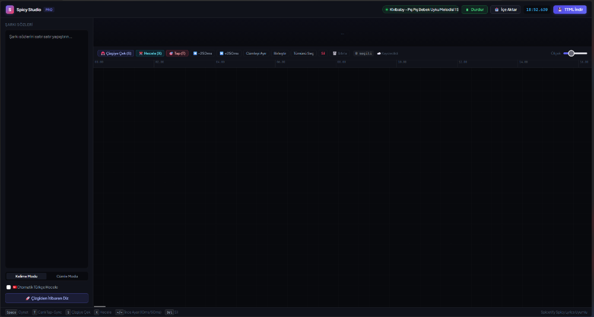
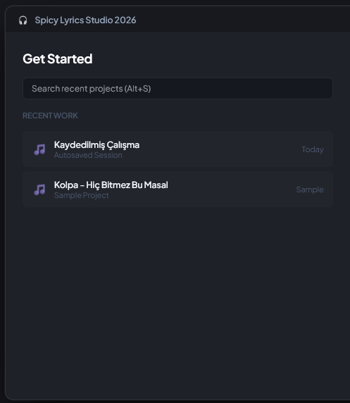
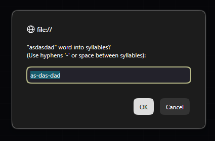

<div align="center">

# 🎵 Spicy Lyrics Studio
### Next-Gen Word & Syllable-Level Lyric Synchronizer for Spicetify Spicy Lyrics

[](https://opensource.org/licenses/MIT)
[](#)
[](https://github.com/spicetify)
[](tests.html)

**Spicy Lyrics Studio** is a precision, timeline-based lyric synchronization workbench engineered specifically for the Spicetify community. It connects directly into desktop Spotify via Windows GSMTC (Global System Media Transport Controls) to extrapolate sub-frame playback timing, allowing real-time seek, live tap-to-sync, algorithmic Turkish syllable hyphenation, and export of zero-defect `.ttml` lyric files.

[Quick Start](#-quick-start) • [Visual Tour](#-visual-tour) • [Key Features](#-key-features) • [Architecture](#-architecture) • [Testing & Reliability](#-testing--reliability)

---



</div>

---

## 📸 Visual Tour

| **Visual Studio 2026 Launcher** | **Custom Dark Modals & Syllable Engine** |
|:---:|:---:|
|  |  |
| *Session history, search & one-click resume* | *Non-blocking dark studio prompt & syllable splitter* |

---

## ✨ Key Features

- **⚡ Native Windows GSMTC Bridge:** Eliminates the need to download local MP3 audio files. Uses real-time sub-frame extrapolation (`DateTime.UtcNow - LastUpdatedTime`) to sync directly with desktop Spotify on `localhost:48484`.
- **✂️ Syllable-by-Syllable Synchronization:** Adheres strictly to Spicy Lyrics' syntax: consecutive inline spans (`<span>kur</span><span>tar</span><span>sana</span> `) with trailing whitespace strictly applied to the final syllable.
- **🇹🇷 Algorithmic Turkish Hyphenator:** Automatically parses vowel-consonant phonetic structures (e.g. `kork-mu-yo-rum`, `vaz-geç-mek`, `a-dım-la-rım`) to split Turkish words into syllables with zero manual typing.
- **🎯 Live Tap-to-Sync (`T` Key):** Listen to Spotify in real time; each tap locks the playhead to the next word or syllable and cascades subsequent blocks forward.
- **🎛️ Micro-Nudge Keyboard Controls:** Fine-tune timing with `10ms` (Arrow Keys) and `50ms` (`Shift` + Arrows) increments; extend or trim block durations with `Alt` + Arrows.
- **🌐 Autonomous Lyric Retrieval:** Integrated LRCLIB API client pulls plain lyrics or existing timestamped `.lrc` tracks directly from Spotify's current song metadata.
- **📁 Production Project System:** Export/import full workspace states as `.json` project files, combined with resilient `localStorage` auto-saving.

---

## 🚀 Quick Start

### One-Click Launch (Recommended)
Simply double click **`Baslat_Studio.bat`**. It will automatically:
1. Check if the Spotify GSMTC background bridge is running (and launch it in background if not).
2. Open the studio interface directly in your default browser.

```cmd
Baslat_Studio.bat
```

### Manual Launch
If you prefer running components individually:
```cmd
# 1. Start Spotify Bridge (C# .NET)
Spotify_Koprusunu_Baslat.bat

# 2. Open Studio in any browser
Timeline_Editor.html
```

---

## 🧪 Testing & Reliability

The studio includes an automated test runner ([`tests.html`](tests.html)) covering critical edge cases:

- **Turkish Syllable Hyphenator:** Multi-syllable validation, compound consonant clusters, and monosyllabic resilience.
- **Parser Robustness:** Millisecond time string conversions (`01:23.456` ↔ `83.456s`) and TTML standard formatters.
- **Spicy Lyrics Syntax Integrity:** Ensures syllable spans are never nested and trailing spaces only appear on terminating syllables.
- **Fault-Tolerance:** Deserialization of corrupted, partial, or malformed JSON projects without crashing the DOM.

> To run the test suite, simply open `tests.html` in any browser.

---

## ⌨️ Keyboard Shortcuts Reference

| Shortcut | Action | Description |
| :--- | :--- | :--- |
| **`Space`** | **Play / Pause** | Toggle Spotify playback via GSMTC |
| **`T`** | **Tap-to-Sync** | Lock next block to playhead in real time |
| **`S`** | **Snap** | Pull selected block to current playhead |
| **`X`** | **Syllables** | Split selected word into syllables |
| **`←` / `→`** | **Nudge 10ms** | Fine-tune block timing by ±10ms |
| **`Shift` + `←` / `→`** | **Nudge 50ms** | Shift selected block by ±50ms |
| **`Alt` + `←` / `→`** | **Duration** | Expand / trim block end boundary by 10ms |
| **`Del` / `Backspace`** | **Delete** | Remove selected block(s) |
| **`Ctrl` + `A`** | **Select All** | Select all clips on active tracks |
| **`Esc`** | **Dismiss** | Close active dialogs or launcher window |

---

## 📦 Project Architecture

```text
SpicyLyricsSync/
├── Baslat_Studio.bat          # One-click studio & bridge launcher
├── Timeline_Editor.html       # Clean semantic studio layout
├── style.css                  # Studio design system & animations
├── app.js                     # Core synchronization & editor engine
├── tests.html                 # Automated test suite
├── docs/images/               # UI preview assets & screenshots
├── Spotify_Koprusunu_Baslat.bat # Spotify bridge launcher
├── Spotify_Koprusu.ps1        # PowerShell GSMTC wrapper
└── SpotifyBridge/             # Windows GSMTC C# console server
    ├── Program.cs             # HttpListener & GSMTC extrapolation
    └── SpotifyBridge.csproj   # .NET 10 Windows SDK project
```

---

## 📄 License
Distributed under the **MIT License**. Created with ❤️ for the Spicetify community.
